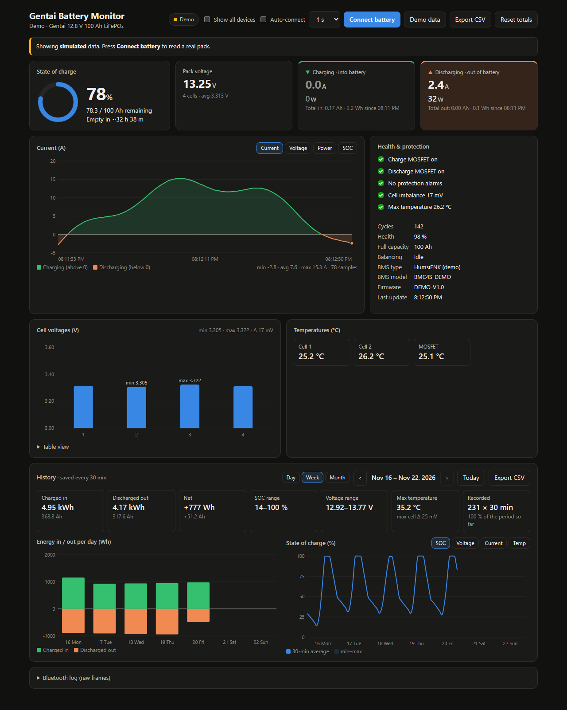
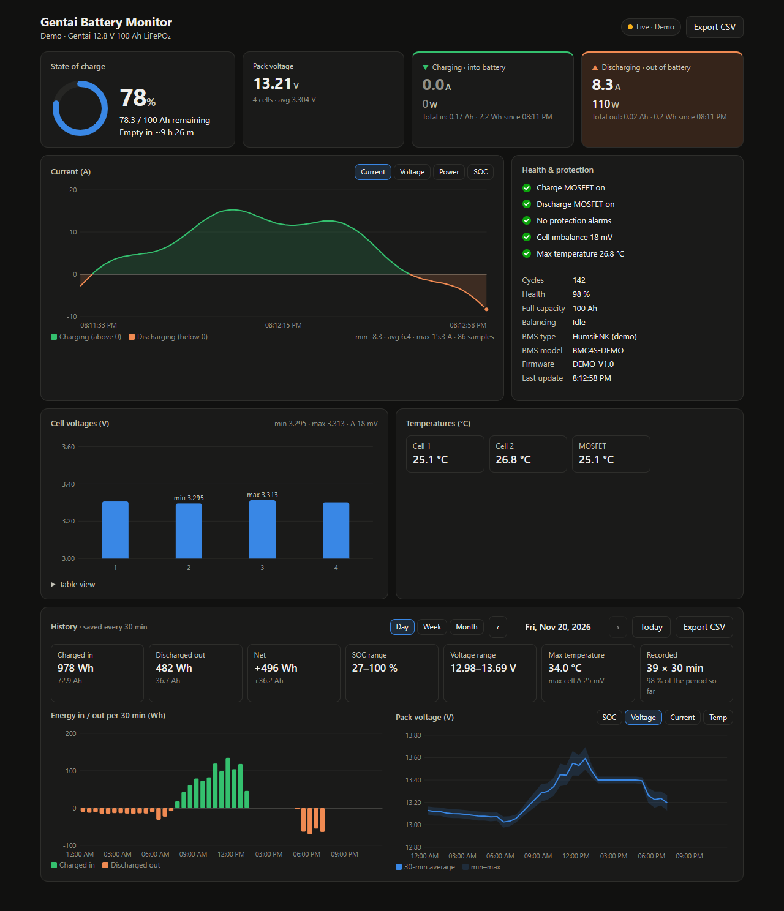

# Gentai Battery Monitor

A live dashboard for **Gentai Power LiFePO₄ batteries** with Bluetooth. It reads the battery directly over Bluetooth from a Windows PC, keeps a 30-minute history in a small database, and can be shared over the internet as a password-protected, read-only page.

No cloud account, no phone app, and no `npm install`. It is one HTML page and one Node.js script.

> **Which batteries?** Gentai packs don't all use the same battery management system (BMS), so the dashboard speaks two protocols and **detects the right one automatically** when it connects:
>
> | BMS | How it shows up | Notes |
> | --- | --- | --- |
> | **HumsiENK** | `DCH…` (for example `DCH842F`), `HS…`, `ECO…` | Confirmed on a Gentai 12.8 V pack. Reports health %, 6 named temperature sensors, warnings as well as protections, and heater state. |
> | **JBD** (Jiabaida / Xiaoxiang) | `SP…`, `JBD…`, `xiaoxiang…` | Named in Gentai's own listings (*"Built in JBD BMS"*). Also works with other brands that use a JBD BMS. |

Other brands that use either of these BMS types should work too.

## Screenshots

**On the PC next to the battery** (full controls, here in demo mode with the History panel on *Week*):



**Remote view through a tunnel** (after entering the password; read-only, so the connection controls and Bluetooth log are hidden, and History is on *Day*):



<sub>Screenshots use the built-in demo data and sample history, not a real battery. The page follows your system's light or dark theme.</sub>

## Features

- **Live readings:** state of charge, pack voltage, cell voltages, temperatures, cycles, and full capacity.
- **BMS status:** charge/discharge MOSFETs, each active protection or warning by name (for example *Cell overvoltage warning* or *Discharge overcurrent protection*), which cells are balancing, disconnected cells and heater state (HumsiENK).
- **Automatic BMS detection:** HumsiENK or JBD, including JBD boards on HM-10-style Bluetooth modules.
- **Charge and discharge side by side:** amps and watts going into and out of the battery, with running Ah/Wh totals for both directions.
- **Trend chart** of current, voltage, power or SOC for the last hour or so.
- **History by day, week or month**, saved as one summary row every 30 minutes (about 3 MB a year). It shows energy in and out per period, SOC, voltage, current and temperature, and exports to CSV.
- **Auto-connect:** reconnects to the last battery when started and retries if it goes out of range.
- **Remote viewing** through a Cloudflare or ngrok tunnel, behind a password.
- **Demo mode** to try the dashboard without a battery.

## How it works

```
 Battery ──Bluetooth LE──▶ Edge/Chrome window on the PC ──▶ serve.js ──▶ history.db
 (HumsiENK or JBD BMS)     (http://localhost:8766)          │
                                                            └──▶ tunnel (optional) ──▶ phones / other PCs
                                                                                       (read-only, password)
```

- The **browser window on the PC** talks to the battery using Web Bluetooth. It is the only part that touches the battery, so it must stay open.
- **`serve.js`** serves the page, saves settings to `config.json`, stores the 30-minute history in `history.db`, and relays live readings to remote viewers.
- **Remote viewers** connect through a tunnel. Their browser can't reach a battery next to your PC, so they get a live, read-only copy of what the PC window sees.

> **This can't be hosted on a cloud server, GitHub Pages or Vercel.** Bluetooth range is about 10 m, so the program must run on a computer near the battery. "Deploying" here means setting up that PC and, if you want, a tunnel so you can watch from anywhere.

## Requirements

| What | Notes |
| --- | --- |
| Windows 10 or 11 PC with Bluetooth LE | Within about 10 m of the battery. A small always-on mini PC or laptop works well. |
| [Node.js](https://nodejs.org) **22.5 or newer** | The history database uses SQLite built into Node 22.5+. On older versions the dashboard still works, but history is turned off. |
| Microsoft Edge or Google Chrome | Needed for Web Bluetooth. Firefox and Safari don't support it. |
| A Gentai battery with Bluetooth (or another HumsiENK / JBD BMS pack) | The chooser lists devices that advertise a HumsiENK or JBD service, or whose names start with `DCH`, `HS`, `ECO`, `GENTAI`, `GT`, `SP`, `JBD`, `DP` or `xiaoxiang`. |

> **Close the phone app.** The BMS accepts only one Bluetooth connection at a time. If the battery's app on your phone is connected, the dashboard can't connect or gets no answer.

macOS and Linux should work by running `node serve.js --open` directly, but only Windows has been tested and only Windows has the `.bat` helpers.

---

## Deployment guide

### 1. Install Node.js

Open **PowerShell** and run:

```powershell
winget install OpenJS.NodeJS.LTS
```

Close and reopen PowerShell, then check the version is 22.5 or newer:

```powershell
node --version
```

### 2. Download the dashboard

With Git:

```powershell
git clone https://github.com/<your-user>/Gentai-Dashboard.git
cd Gentai-Dashboard
```

Or click **Code → Download ZIP** on GitHub and extract it to a folder such as `C:\Gentai-Dashboard`.

### 3. Create your settings file

Copy the example file:

```powershell
copy config.example.json config.json
```

Open `config.json` in Notepad and change `remotePassword` to a long password of your own. You only need this for remote viewing. If you'll only use the dashboard on this PC, you can delete that line.

> `config.json` is listed in `.gitignore`, so your password is never uploaded to GitHub.

### 4. Start it and connect the battery

Double-click **`start.bat`**.

This starts the server and opens the dashboard in its own Edge or Chrome window, with a separate browser profile that allows silent reconnecting.

1. Click **Connect battery**.
2. Choose your battery from the list. If it isn't listed, tick **Show all devices** and try again. Gentai packs usually show up with a code rather than "Gentai": `DCH…` (for example `DCH842F`) for HumsiENK, or `SP04S…` for JBD.
3. Readings appear within a few seconds.

From now on the dashboard reconnects to that battery on its own each time `start.bat` runs. Leave the black server window and the dashboard window open.

Want to look around first? Click **Demo data**. Demo readings are never saved to the history.

### 5. Keep it running (recommended)

History is only recorded while the dashboard window is open and connected. For around-the-clock monitoring:

- **Start automatically when you sign in:** press `Win + R`, type `shell:startup`, press Enter, and put a **shortcut** to `start.bat` in the folder that opens.
- **Stop the PC from sleeping:** Settings → System → Power → set *Sleep* to **Never** (at least when plugged in).
- **Sign in automatically after a power cut (optional):** turn on automatic sign-in for this PC, or use a PC that is always signed in. The browser window needs a signed-in desktop session.
- Minimising the dashboard window is fine. `start.bat` launches the browser with background throttling turned off, so readings keep flowing.

### 6. View it from anywhere (optional)

Remote access goes through a **tunnel**: a small program on the PC that gives the dashboard a public `https://` address without opening ports on your router. Remote visitors must enter the `remotePassword` from `config.json`. Any user name works. After 10 wrong attempts, the visitor's IP address is locked out for 15 minutes.

Pick one of the two options below.

#### Option A: Cloudflare quick tunnel (free, no account)

```powershell
winget install --id Cloudflare.cloudflared
```

Then run **`tunnel.bat`** (with `start.bat` already running). Look for a line like:

```
https://random-words-here.trycloudflare.com
```

Open that address on your phone. **The address changes every time** you run `tunnel.bat`.

#### Option B: ngrok with a fixed address (free account)

1. Sign up at [ngrok.com](https://ngrok.com), then install ngrok:
   ```powershell
   winget install --id Ngrok.Ngrok
   ```
2. Add your auth token (from the ngrok dashboard → *Your Authtoken*):
   ```powershell
   ngrok.exe config add-authtoken YOUR_TOKEN
   ```
3. Claim your free static domain in the ngrok dashboard (*Domains*) and save it once:
   ```powershell
   setx GENTAI_NGROK_URL https://your-name.ngrok-free.app
   ```
   Open a new terminal afterwards so the setting takes effect.
4. Run **`ngrok.bat`**. It checks the setup, starts the dashboard if it isn't running, and opens the tunnel. The address stays the same every time, so you can bookmark it on your phone.

If you skip step 3, ngrok uses a random address each run.

> To have the tunnel start at sign-in too, put a shortcut to `tunnel.bat` or `ngrok.bat` in the `shell:startup` folder as well.

### 7. Updating

```powershell
git pull
```

Then close the server window and run `start.bat` again. Your `config.json` and `history.db` are kept.

---

## Running next to the WattCycle dashboard

This project is a sibling of [WattCycle Battery Monitor](https://github.com/<your-user>/WattCycle-Dashboard), and both can run on the same PC at once:

| | WattCycle | Gentai |
| --- | --- | --- |
| Address | `http://localhost:8765` | `http://localhost:8766` |
| Password variable | `WATTCYCLE_PASSWORD` | `GENTAI_PASSWORD` |
| ngrok domain variable | `NGROK_URL` | `GENTAI_NGROK_URL` |
| Browser profile | `%LOCALAPPDATA%\WattCycleDashboard` | `%LOCALAPPDATA%\GentaiDashboard` |

Each has its own `config.json` and `history.db`. A free ngrok account gives you only one static domain, so to share both remotely, use a Cloudflare quick tunnel for one of them.

## Configuration

Settings are saved in `config.json` next to `serve.js`. Most are written by the dashboard itself when you change them on the page.

| Key | Set by | Meaning |
| --- | --- | --- |
| `remotePassword` | you, by hand | Password for remote viewers. If missing, remote access is turned off. The page never reads or changes it. |
| `deviceId`, `deviceName` | dashboard | The battery to auto-connect to. |
| `autoConnect` | dashboard | Reconnect automatically on start (default on). |
| `interval` | dashboard | Polling interval in ms: 1000, 2000, 5000 or 10000. |
| `allDevices` | dashboard | Show every Bluetooth device in the chooser. |
| `trendMetric` | dashboard | Which trend chart tab is selected. |

Environment variables:

| Variable | Meaning |
| --- | --- |
| `GENTAI_PASSWORD` | Remote password. Overrides `remotePassword` in `config.json`. |
| `PORT` | Server port (default `8766`). Keep it fixed: the browser remembers Bluetooth permission per port. |
| `GENTAI_NGROK_URL` | Static ngrok domain used by `ngrok.bat`. |

## What the BMS reports

On connect, the dashboard tries each protocol in turn and keeps whichever one answers, trying that one first next time:

1. **HumsiENK:** service `0001` (write `0002`, notify `0003`). It sends the `0x00` handshake.
2. **JBD:** service `FF00`, then HM-10-style `FFE0` and `FFF0` modules. It sends the `0x03` basic-info request.

The *BMS type* row in the Health panel shows which one was found.

### HumsiENK

| Command | Contents |
| --- | --- |
| `0x20` status (every poll) | Charge/discharge MOSFETs, heater, 29 protection/warning flags, balancing cells, disconnected cells |
| `0x21` battery info (every poll) | Pack voltage, current, SOC, **health %**, remaining and full capacity, cycles, temperatures (4 cell sensors, MOSFET, ambient) |
| `0x22` cell voltages (every poll) | One voltage per cell |
| `0x11` model, `0xF5` firmware (once) | Shown as *BMS model* and *Firmware* |

### JBD

| Command | Contents |
| --- | --- |
| `0x03` basic info (every poll) | Pack voltage, current, remaining and full capacity, cycles, production date, balancing cells, protection flags, BMS version, SOC, MOSFET state, temperatures |
| `0x04` cell voltages (every poll) | One voltage per cell |
| `0x05` device name (once) | The BMS's name. Some boards don't answer, which is fine. |

The JBD BMS doesn't report a health percentage, so that row is hidden. Compare *full capacity* with the battery's rated Ah to judge wear. JBD temperature probes are listed as *Sensor 1, 2, 3…* because their placement depends on how each pack was built.

Temperature sensors that aren't fitted in your pack may show a fixed or unrealistic value. That comes from the BMS, not the dashboard.

## History database

- **File:** `history.db` (SQLite) next to `serve.js`. Whenever the server starts and the file is missing, it is created automatically, empty. Existing data is never overwritten.
- **What's stored:** one row per 30 minutes. Each row has the average, min and max for voltage, current and SOC; average power; SOC at the end of the half hour; highest temperature; worst cell imbalance (mV); and Ah/Wh charged in and discharged out.
- **Size:** 48 rows a day, roughly 3 MB a year.
- **Gaps:** time when the dashboard window wasn't connected is shown as a gap, not guessed.
- **Safety:** the half hour in progress is saved every 5 minutes and when the server window closes normally. If the PC loses power, up to 5 minutes can be lost.
- **Backup:** copy `history.db` while the server is stopped.
- **Start over:** stop the server and delete `history.db`.
- **Use the data elsewhere:** click **Export CSV** in the History panel, or open `history.db` in any SQLite tool (for example [DB Browser for SQLite](https://sqlitebrowser.org)). The table is called `history`; the `t` column is the start of each half hour in milliseconds since 1970 (UTC).

Charge and discharge are worked out from the battery's single current sensor, which measures the **net** flow. If a charger and a load run at the same time, you see the difference between them, not both separately.

## API

| Method and path | Who | Description |
| --- | --- | --- |
| `GET /` | all | The dashboard page. |
| `GET /api/session` | all | `{ "role": "local" }` or `{ "role": "remote" }`. |
| `GET /api/stream` | all | Server-Sent Events: a snapshot, then live readings. |
| `GET /api/history?from=<ms>&to=<ms>` | all | 30-minute history rows between two timestamps. |
| `GET /api/config`, `POST /api/config` | this PC only | Read or update settings (the password is never returned). |
| `POST /api/data` | this PC only | Readings pushed by the dashboard window. |

The server listens on `127.0.0.1` only. Requests arriving through a tunnel are treated as remote and must give the password.

## Troubleshooting

| Problem | Fix |
| --- | --- |
| "This browser has no Web Bluetooth" | Use Edge or Chrome, and open the page as `http://localhost:8766` (not the PC's IP address). |
| Battery not in the device list | Close the battery's phone app, move closer, and tick **Show all devices**. Check that Bluetooth is on in Windows. |
| "… did not answer as a HumsiENK or JBD BMS" | None of the known protocols replied. Check that you picked the battery and not another device: tick **Show all devices** and look for an entry named `DCH…`, `SP…` or similar. If it still fails, open **Bluetooth log (raw frames)**: it lists the services the device offers, which identifies the BMS type. If it mentions a TDT BMS, use the WattCycle dashboard instead. Otherwise, open an issue with that list. |
| "Connection attempt failed" / "Could not open a Bluetooth link" | Windows couldn't open the link (the dashboard already retried 4 times). Fully close the phone app or turn off the phone's Bluetooth. If the battery appears under Windows Settings → Bluetooth &amp; devices, **remove** it (Web Bluetooth doesn't need pairing, and pairing can block it). Make sure no other dashboard window is open, then try again. Turning Windows Bluetooth off and on also clears a stuck link. |
| "The battery is not answering" | The phone app is probably still connected. Close it fully (swipe it away) or turn off the phone's Bluetooth. |
| Doesn't auto-connect after a restart | Start with `start.bat`, not by opening the page in your normal browser. The dashboard needs its own browser profile. If it says permission was lost, click **Connect battery** once. |
| History says "needs Node.js 22.5 or newer" | Update Node.js (`winget upgrade OpenJS.NodeJS.LTS`) and restart. |
| Remote page says "Remote access is turned off" | Add `remotePassword` to `config.json` and restart `start.bat`. |
| Remote page shows "PC window silent" | The dashboard window on the PC was closed, or the PC went to sleep. |
| Port 8766 already in use | Another copy is already running. Close it, or set a different `PORT`. Changing the port means picking the battery once more. |

Open **Bluetooth log (raw frames)** at the bottom of the dashboard to see every message to and from the battery. HumsiENK requests look like `aa 21 00 21 00` and replies start with `aa 21 1a …`. JBD requests look like `dd a5 03 00 ff fd 77` and replies start with `dd 03 00 …`.

## Project files

| File | Purpose |
| --- | --- |
| `index.html` | The whole dashboard: HumsiENK and JBD Bluetooth drivers, charts and history views. |
| `serve.js` | Local web server, settings, history database, and live relay for remote viewers. |
| `start.bat` | Starts the server and opens the dashboard window. |
| `tunnel.bat` | Opens a Cloudflare quick tunnel. |
| `ngrok.bat` | Opens an ngrok tunnel (optionally with a fixed domain). |
| `config.example.json` | Template for `config.json`. |
| `docs/screenshots/` | Images used in this README. |

## Security notes

- Never commit `config.json`. It holds your remote password and is listed in `.gitignore`.
- Use a long, unique remote password. The tunnel uses HTTPS, so the password is encrypted in transit.
- Remote viewers can only **look**. They can't connect, disconnect, change settings or send commands to the battery.
- The dashboard only **reads** from the BMS. It never writes settings or switches the MOSFETs.
- To stop sharing, close the tunnel window. The dashboard keeps working locally.

## Credits

The Bluetooth protocols follow the `humsienk_bms` and `jbd_bms` plugins of [aiobmsble](https://github.com/patman15/aiobmsble) (Apache-2.0) and its HumsiENK protocol notes. aiobmsble is used by the Home Assistant [BMS_BLE](https://github.com/patman15/BMS_BLE-HA) integration.

Not affiliated with or endorsed by Gentai Power, HumsiENK or Jiabaida (JBD).
